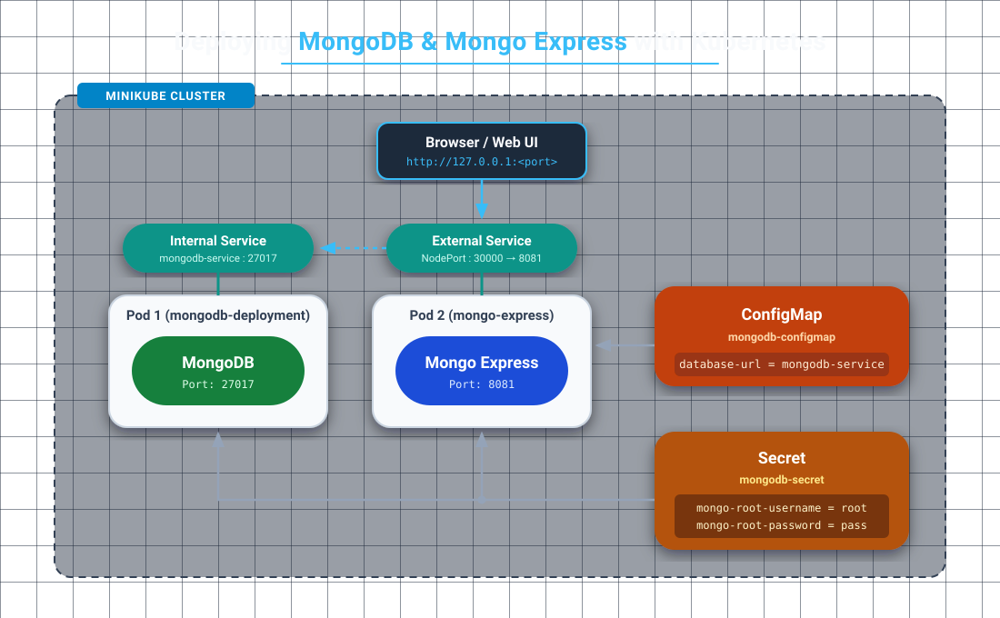

# Deploying MongoDB & Mongo Express with Kubernetes (Minikube)

A complete Kubernetes setup deploying **MongoDB** and **Mongo Express** on a local Minikube cluster using **Deployments**, **Services (ClusterIP & NodePort)**, **ConfigMaps**, and **Secrets**.

## Architecture Flowchart



### How Components Connect

1. **MongoDB Pod (`mongodb-deployment`):** Runs the MongoDB database container on port `27017` initialized with root credentials from `mongodb-secret`.

2. **Internal Service (`mongodb-service` & `mongo`):** Exposes MongoDB internally inside the cluster on port `27017` so Mongo Express can resolve and connect to the database.

3. **Mongo Express Pod (`mongo-express`):** Runs the web-based MongoDB admin interface on port `8081`, reading the database host from `mongodb-configmap` and credentials from `mongodb-secret`.

4. **External Service (`mongo-express-service`):** Exposes Mongo Express outside the cluster via `NodePort` (`30000` -> `8081`) for browser access.

5. **ConfigMap (`mongodb-configmap`):** Stores non-sensitive configuration (`database-url: mongodb-service`).

6. **Secret (`mongodb-secret`):** Stores base64-encoded credentials (`mongo-root-username` and `mongo-root-password`).

## Project Structure

```text
Kubernetes/
├── kubernetes_architecture_flowchart.svg   # Kubernetes deployment architecture diagram
├── mongo-secret.yaml                       # Base64-encoded MongoDB root username & password
├── mongo-configmap.yaml                    # Database host configuration (mongodb-service)
├── mongo-deployment.yaml                   # MongoDB Deployment & internal ClusterIP Service
├── mongo-express.yaml                      # Mongo Express Deployment, NodePort Service & mongo alias Service
└── README.md                               # Project documentation
```

## Prerequisites

* [Docker Desktop](https://www.docker.com/products/docker-desktop/)
* [Minikube](https://minikube.sigs.k8s.io/docs/start/)
* [kubectl](https://kubernetes.io/docs/tasks/tools/)

## Quick Start

### 1. Start Minikube

```bash
minikube start
```

### 2. Apply Kubernetes Manifests

Deploy the Secret, ConfigMap, MongoDB, and Mongo Express resources:

```bash
kubectl apply -f mongo-secret.yaml
kubectl apply -f mongo-configmap.yaml
kubectl apply -f mongo-deployment.yaml
kubectl apply -f mongo-express.yaml
```

### 3. Verify Pods and Services

Confirm all pods are in the `Running` (`1/1`) state:

```bash
kubectl get pods
kubectl get svc
```

### 4. Open Mongo Express in the Browser

Start the Minikube service tunnel (keep the terminal window open while using the Docker driver on Windows):

```bash
minikube service mongo-express-service
```

* **Default Web UI Login:** `admin` / `pass`

## Cleanup

Delete all resources from your Minikube cluster:

```bash
kubectl delete -f mongo-express.yaml
kubectl delete -f mongo-deployment.yaml
kubectl delete -f mongo-configmap.yaml
kubectl delete -f mongo-secret.yaml
```